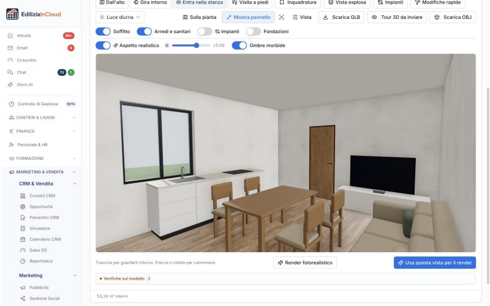
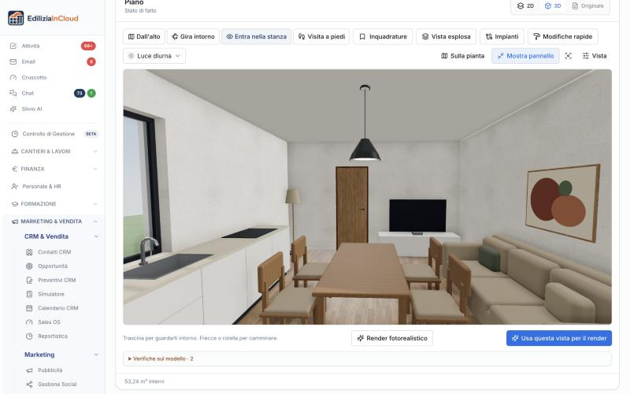
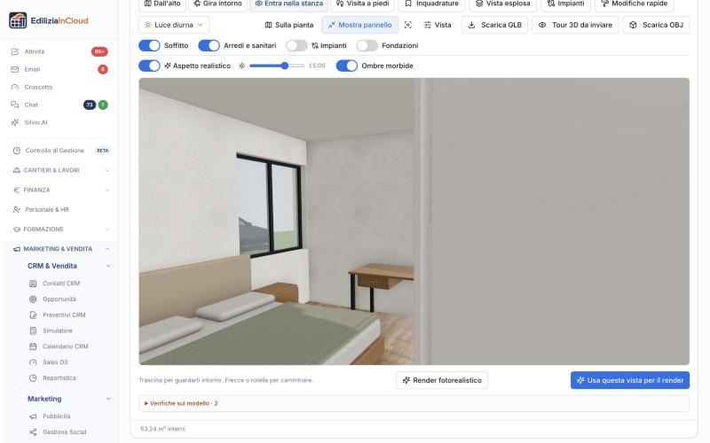
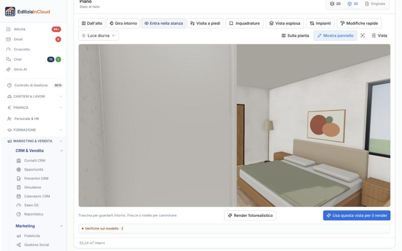
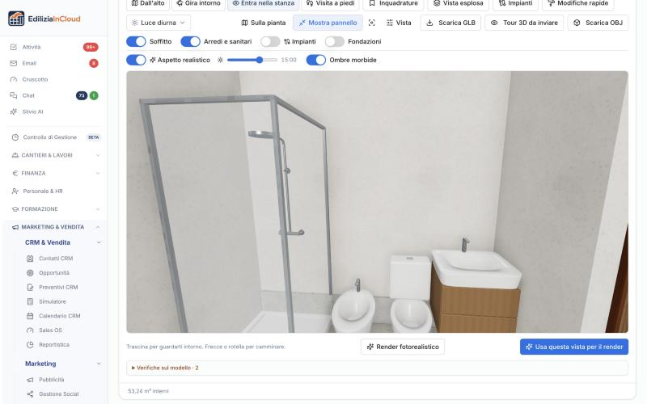
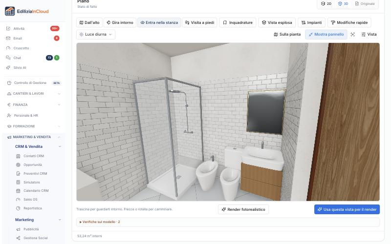
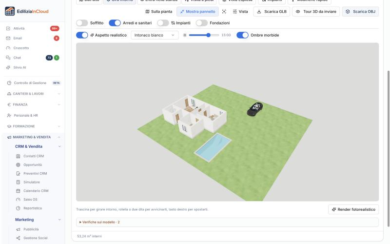
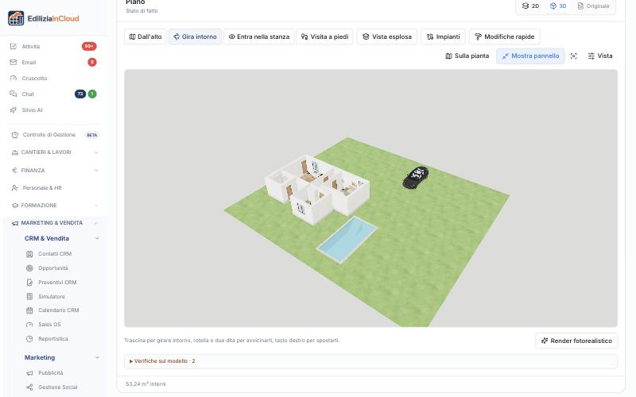
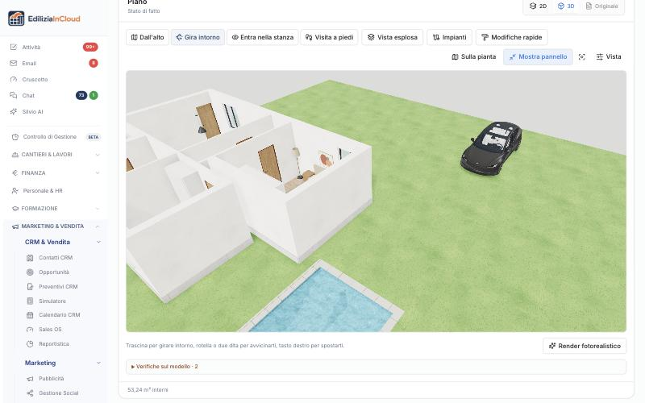
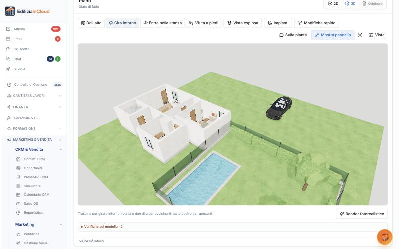

# 3D delle planimetrie: piano per migliorare la resa (23/11/2026)

Riguarda il 3D gratuito nel browser (`/azienda/planimetrie`, «Guarda in 3D») e, di riflesso, il
fotorealistico nel browser e i render AI, che partono dalla stessa scena.
Vincolo: nessun costo fisso nuovo, nessuna risorsa con licenza non libera, pagina leggera.

## Com'era (foto «prima» sulla pianta di prova in Demo 2)

Cinque scene: soggiorno con cucina, camera, bagno, esterno con giardino, piscina e auto.
Stesse inquadrature per il «dopo» (`?vista=3d&locale=l1|l3|l5`, «Entra nella stanza» e «Gira intorno»).

| Difetto visto | Da dove viene |
| --- | --- |
| Bagno e cucina con pavimento a tinta unita o con fughe disegnate da 1 pixel | materiali: `pavimento_piastrelle`, `pavimento_gres` e i campioni «piastrelle»/«cemento» non hanno una vera texture né rilievo |
| Il parquet corre sempre nello stesso verso, anche di traverso alla stanza | materiali: la texture non ha orientamento; manca la posa (dritta, diagonale) |
| Muri che finiscono nel pavimento senza battiscopa | geometria: non esiste |
| Dai vetri, da dentro, si vede un grigio piatto | resa: sfondo a tinta unita, il cielo c'è solo nelle viste da fuori |
| Stanze senza lampade: la luce «di sera» non ha una sorgente visibile | geometria + luce |
| Stanze arredate ma spoglie (niente tappeto, tende, quadri, piante) | arredi: `arredaStanza` posa solo i mobili principali |
| In camera l'inquadratura di partenza finisce contro l'armadio | resa: scelta della telecamera |
| Esterno: prato piatto fino al bordo, nessuna siepe o recinzione, acqua piatta | geometria + materiali |
| Bagno con pareti nude | scelta di progetto (il rivestimento si sceglie nello Studio): si propone con l'AI, non si impone |

Già buono e da non rifare: campioni PBR veri (rovere, marmo, tessuto, impiallacciatura, CC0), modelli
Poly Haven (CC0), cucine, sanitari, docce e letti parametrici, ombre, occlusione, sole per ora e nord,
«arreda …» in chat con anteprima e annulla, salvataggio delle finiture nella pianta.

## Lotti (in ordine di resa per sforzo)

1. **Pavimenti e materiali.** Piastrelle vere generate dal codice (gres 60×60, 30×60, 120×120, cotto 30×30,
   mosaico, resina) con fughe, rilievo e lucentezza; misura reale che non cambia con la stanza; posa dritta,
   diagonale o ruotata, salvata nella pianta; parquet orientato da solo lungo il lato lungo; registro di
   provenienza e licenza di ogni texture.
2. **Dettagli della stanza.** Battiscopa lungo i muri (interrotto alle porte); cielo e luce dietro i vetri;
   plafoniere vere collegate alla luce della sera.
3. **Arredo di contorno e inquadrature.** «Arreda» aggiunge tappeto, tende, quadro, pianta e lampada dove
   c'è posto (con controllo degli ingombri); inquadratura di partenza che non finisce contro un mobile.
4. **Esterni.** Siepe e recinzione sul confine, acqua della piscina con riflessi, prato meno piatto, alberi.
5. **Chiederlo all'AI.** «Parquet a spina in soggiorno», «pareti salvia in camera», «gres 60×60 in bagno
   posato in diagonale»: comandi di codice (numeri e ingombri calcolati dal codice), con anteprima e annulla.
6. **Prestazioni.** Profilo leggero per telefono (texture più piccole, niente occlusione), misura dei tempi.

## Cosa serve dall'altra sessione (pianta → computo)

Una finitura scelta nel 3D resta una descrizione nel locale (`finiture.pavimento`, più la nuova
`finiture.posaPavimento`). Per legarla a un prodotto e ai prezzi serve, nei file del computo:
leggere `posaPavimento` (la posa diagonale ha più sfrido: di norma +10/15% di materiale) e la misura del
formato (`formatoCm` del campione in `shared/planimetrie/finiture.ts`).

Lo stato di avanzamento e le misure sono in fondo, aggiornati a ogni lotto.

## Avanzamento (sera del 23/11/2026)

Prima e dopo, stessa pianta (`PROVA Claude 23/11` in Demo 2), stessi comandi («Entra nella stanza», «Gira intorno»):

| Scena | Prima | Dopo |
| --- | --- | --- |
| Soggiorno con cucina |  |  |
| Camera |  |  |
| Bagno |  |  |
| Esterno |  |  |

Le immagini sono ridotte (800 px): le fughe sottili delle piastrelle a parete lì si vedono a metà.
Sulla tela vera sono una ogni 7,5 cm, misurate sui pixel.

### Fatto e provato a schermo

- **Lotto 1, pavimenti e materiali.** Otto piastrelle e resine disegnate dal codice (`tred/trameGenerate.ts`):
  colore, rilievo delle fughe e lucentezza, senza file da scaricare e senza licenze. Formato reale scritto nel
  campione (`formatoCm`) e controllato da un test. Bagno e cucina hanno piastrelle 60×60 vere anche senza
  scegliere niente. Sei campioni nuovi: gres grande formato, gres antracite 30×60, resina, mosaico 5×5,
  piastrelle da parete 7,5×15 bianche e salvia. Posa «dritta / di traverso / in diagonale» nello Studio
  (Superfici → Pavimento → Posa), salvata nella pianta (`finiture.posaPavimento`) e ritrovata alla riapertura.
  Il parquet corre da solo lungo il lato lungo della stanza e segue i muri anche in una casa ruotata.
  Le stesse texture e la stessa posa vanno nel file GLB.
- **Lotto 2, dettagli.** Battiscopa lungo i muri, interrotto alle porte, assente dove il rivestimento arriva a
  terra (stessa regola del fabbisogno). Dai vetri si vede il cielo dell'ora scelta.
- **Lotto 3, arredo di contorno.** «Arreda …» ora aggiunge, solo dove c'è posto: lampada sopra il tavolo,
  piantana, quadro sopra divano o letto, tende alle finestre libere, tappeto e tavolino davanti al divano,
  specchio sopra il lavabo, scaldasalviette, pianta. Stessi controlli di ingombro dei mobili; un comando
  per un solo mobile («divano in soggiorno») non aggiunge niente altro.

- **Lotto 4, esterni (prima parte).** Acqua della piscina increspata, che muove i riflessi; mosaico vero sul
  fondo e sulle pareti della vasca; pavimentazione esterna e marciapiede con le fughe; prato con un po' di
  rilievo; sole più deciso nella vista da fuori, così le ombre staccano.
  

- **Lotto 4, verde e recinzione.** In chat: «arreda il giardino» mette la siepe sui lati liberi del prato e fino
  a tre alberi negli angoli lontani dalla casa; «siepe intorno al giardino», «alberi in giardino» e
  «recinzione intorno al giardino» fanno una cosa sola. Niente finisce sopra piscina, auto o altri oggetti, né
  contro i muri di casa; i metri di siepe scritti in chat sono la somma dei pezzi posati. Con anteprima e
  annulla, come gli altri comandi. Nel 3D gli alberi hanno tronco e chioma a più masse, la siepe ha i ciuffi,
  la recinzione ha muretto, pali e rete e salta i tratti lungo la casa.
  

### Solo impostato o non fatto

- **Inquadratura della camera**: parte ancora con mezzo fotogramma coperto. Ho provato una correzione al
  punteggio della telecamera, non ha cambiato il risultato e l'ho tolta. Va capito cosa copre la vista.
- **Esterni, il resto**: cielo nella vista «Gira intorno» dello Studio (oggi lo sfondo è grigio per scelta),
  prato con fili d'erba veri, percorsi e luci da giardino posati da soli.
- **Finiture chieste in chat (lotto 5)**: «arreda …» in chat c'era già e ora fa di più; i comandi per le
  finiture («parquet a spina in soggiorno», «gres in diagonale in bagno») non sono stati scritti: si fanno
  dallo Studio. Il file dei comandi (`editor/comandiChat.ts`) ha modifiche non pubblicate di un'altra sessione.
- **Prestazioni (lotto 6)**: solo la metà risoluzione delle piastrelle generate sul telefono. Nessuna misura
  di tempi e fluidità.
- **Parquet a spina con posa libera**: resta il campione fotografico «rovere a spina»; la spina non è una posa
  applicabile agli altri legni.
- **Fotorealistico nel browser e render AI**: partono dalla stessa scena, quindi ricevono piastrelle, posa e
  battiscopa, ma non li ho provati con queste modifiche.
- **Catalogo con anteprime e varianti (punti 12-13)**, luci serali dedicate, scale, cucine e bagni: non toccati.
