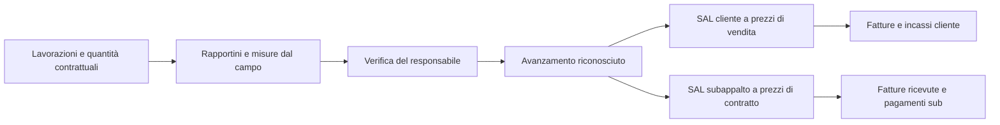

# SAL, verbali, avanzamento e pagamenti dei subappalti

Data: 27/10/2026. Stato: piano di implementazione dopo analisi del codice locale e lettura dei metadati del database collegato. Nessuna modifica ai dati, allo schema o alle funzioni online in questa analisi.

**Vincolo trasversale richiesto dall'utente:** il flusso deve essere fluido e semplice. Riutilizzare i dati già registrati, mantenere la commessa come contesto, presentare una prossima azione chiara e mostrare le opzioni avanzate solo quando pertinenti. I criteri UX della sezione 14 fanno parte dell'accettazione di ogni lotto, non di un restyling finale.

## 1. Obiettivo e decisione centrale

Dalla commessa deve essere possibile capire: che cosa è stato eseguito, da chi, su quali riscontri, quanto è stato riconosciuto al cliente e al subappaltatore, quanto è fatturato, quanto è scaduto e quanto è stato effettivamente incassato o pagato.

Servono fonti operative condivise e contabilità separate per cliente e ciascun contratto di subappalto. Non un unico stato «SAL/pagato» e non due percentuali scollegate inserite a mano.

Lo stesso lavoro può sostenere i due SAL, ma prezzi, voci riconoscibili, date, approvazioni, trattenute e condizioni di pagamento restano indipendenti. Il mancato incasso cliente non rinvia automaticamente il pagamento del subappaltatore.

## 2. Che cosa esiste: riscontri verificati

| Area | Riscontro | Limite da affrontare |
| --- | --- | --- |
| SAL cliente | `sal_records` e `sal_voci`; `SalTab.tsx`; generatore `generate-sal-pdf` | Già cumulativi, con differenza rispetto all'ultimo cumulativo precedente. Le voci non hanno un riferimento strutturato a fase/voce contrattuale nello schema esaminato. |
| Importazione dalle fasi | `salDaFasi.ts` propone nome, percentuale e importo venduto | È una bozza modificabile: non una certificazione automatica del lavoro né un collegamento permanente a misure e riscontri. |
| Maturazione rata cliente | `salMaturazione.ts`, `salRate.ts`, piano pagamenti | La maturazione può dipendere da emissione o approvazione/firma. Va conservata e resa distinta da fatturazione e incasso. |
| Contabilità da computo | `lp_libretto`, `lp_sal`, `lp_sal_voci`, certificati; `SchedaSal.tsx` | Percorso già presente per contabilità lavori: non sostituirlo con un altro SAL equivalente sulla stessa base, né applicarne indiscriminatamente le regole a ogni contratto privato. |
| Contratti sub | `contratti_subappalto`, `ContrattiSubappalto.tsx`; importi, oneri, ritenute, date, firma e riconciliazione fatture | `modalita_pagamento` è testo libero. Mancano modalità di maturazione e scadenze strutturate. Nel record non c'è un elenco prezzi/quantità del contratto. |
| SAL sub | `sal_subappaltatori`: importo lordo, ritenuta, netto, stato, allegato, data e riferimento pagamento | Non risultano colonne per periodo di competenza, righe misurate, progressivo cumulativo, approvatore con data, versione del verbale o registro di pagamenti parziali. |
| Riconciliazione sub | `riconciliazioneContratto.ts` distingue eseguito, approvato, fatturato, pagato e ritenute | L'eseguito include SAL ricevuti non contestati; il da pagare include anche i non verificati; pagato deriva dall'intero netto dei SAL con stato pagato. Sono etichette da chiarire, non denaro riconciliato con movimenti. |
| Pagamento sub nella pagina | `SubappaltatoreDetail.tsx` aggiorna stato/data/metodo/riferimento sul SAL | Il modulo non registra un importo di pagamento parziale. SAL e ritenuta vengono creati da due chiamate distinte. Numerazione proposta con `salList.length + 1`. |
| Verbali sub | Nel percorso esaminato si registra un SAL e si può associare un allegato | Non è stato individuato un generatore di verbale SAL sub equivalente a quello cliente. Un allegato ricevuto e un verbale generato dall'app devono essere distinti. |
| Avanzamento | Fasi/sottofasi, percentuali, foto, rapportini, approvazione; pesi uguali, durata o venduto già configurabili | `CampoAvanzamento.tsx` può aggiornare fasi direttamente secondo i permessi; l'approvazione del rapportino è un altro percorso. Va deciso quali riscontri autorizzano maturazione economica. |
| Rollup | `useAvanzamentoCommessa.ts` usa il calcolo DB per pesi non uguali | Esiste anche `controlloGestione/avanzamentoFasi.ts`, con media alla pari: serve verificare e allineare tutte le proiezioni. Il fallback non deve apparire come la stessa misura quando cambia metodo. |

Metadati live letti: colonne delle nove tabelle principali; vincoli di stato, trigger e policy di contratti/SAL; definizioni delle tre funzioni elencate sotto. Non è stato collaudato ogni percorso con utenti reali o eseguita una transazione economica.

### 2.1 Priorità tecniche emerse dal database

1. Su `campo_rapportini` sono attivi sia `campo_rapportino_avanzamento_approvato()` sia `fn_rapportino_applica_avanzamento()`. Entrambi reagiscono all'approvazione. Il primo considera percentuali dichiarate anche senza il controllo sulle sottofasi presente nel secondo. È un rischio concreto di regole divergenti; riprodurlo in test isolato prima di rimuovere o modificare un trigger.
2. `sal_sub_commessa_dal_contratto()` imposta commessa e sub dal contratto, ma nella definizione letta non verifica anche l'uguaglianza di `company_id`. La nuova scrittura deve validare l'intera catena azienda/contratto/sub/commessa sul server.
3. Le policy `sub_company_1`/`sub_company_2` lette sono ampie a livello aziendale e non esprimono da sole la distinzione tra responsabile operativo e amministrazione. Verificare privilegi effettivi con utenti di prova e separare lettura costi, approvazione e registrazione pagamenti.
4. Nel catalogo dei vincoli letto non compare un UNIQUE sul numero SAL per contratto. Controllare anche gli indici unici e i duplicati preesistenti prima della migrazione; assegnare il numero sul server in transazione.

## 3. Contratto: due scelte indipendenti

Non confondere come si calcola il compenso con quando lo si paga.

| Calcolo del compenso | Esempio |
| --- | --- |
| A corpo | Prezzo concordato per bagno, impianto, posa serramenti o pacchetto di lavori. |
| A misura | Quantità approvata × prezzo unitario del contratto: mq, ml, pezzi ecc. |
| A ore/giornate | Ore/giornate riconosciute × tariffa pattuita, con limiti e autorizzazioni. |
| Misto | Voci a corpo e voci a misura nello stesso contratto, identificate separatamente. |

Per ognuna delle modalità: saldo a fine lavoro, acconto + saldo, traguardi verificabili, SAL periodici, SAL a soglia/importo o combinazione esplicitamente configurata. Anche un lavoro a corpo può avere SAL intermedi.

Campi strutturati: base del compenso; righe/ambito affidato; frequenza o traguardo di maturazione; acconti e loro recupero; percentuale/base ritenuta; evento da cui decorrono i termini; giorni di pagamento; oneri inclusi/separati; responsabile che verifica; soggetto che approva; eventuali condizioni documentali. Le clausole libere rimangono come integrazione. Nessun valore percentuale o blocco normativo imposto indistintamente a tutti i contratti.

Un sub può avere più contratti nella stessa commessa e più commesse: nessun presupposto «una ditta = un contratto». Le varianti modificano il contratto mediante versione/atto approvato; non riscrivono gli importi storici dei SAL emessi.

## 4. Come capire l'avanzamento reale nell'app

### Percorso in cantiere

L'addetto vede cantiere e attività assegnati. Per ogni voce indica quantità eseguita nel periodo o progressivo a una data, sottofasi concluse, eventuale percentuale motivata, foto e impedimenti. Per le quantità distinguere esplicitamente «aggiungo oggi» da «totale eseguito»: non sommare percentuali cumulative inviate da più operai.

Ore, presenze, GPS e foto sono riscontri; da soli non attribuiscono una percentuale di completamento. Una consegna materiali non è posa eseguita. L'AI può aiutare a compilare una proposta dal rapportino, senza approvare misure o importi.

### Verifica e calcolo

- Separare avanzamento dichiarato, riconosciuto e già contabilizzato. Visualizzare autore, verificatore, data di rilevazione, data di verifica e origine.
- A misura: rapporto tra quantità riconosciuta e quantità contrattuale; eventuale eccedenza visibile e gestita come variante, non nascosta in una percentuale oltre 100.
- A corpo: sottofasi/traguardi con pesi concordati oppure percentuale verificata e motivata. Non assegnare peso uguale a una spunta amministrativa e a una lavorazione importante senza una scelta esplicita.
- Aggregazione tra lavorazioni: pesi dichiarati e versionati. Non sommare mq con pezzi o ore. La ponderazione per venduto è un avanzamento valorizzato ai prezzi di vendita, da etichettare come tale.
- Conservare le configurazioni esistenti; rendere evidente il metodo in uso e le voci senza quantità/importi/date sufficienti. «Non determinabile» è diverso da 0%.
- Una lavorazione con più imprese ha ambiti/quantità assegnati distinti. La stessa quantità riconosciuta non può essere contabilizzata due volte sullo stesso contratto.
- Correzioni, rifiuti, riaperture e rifacimenti creano rettifiche motivate con storico. Non abbassare o alzare silenziosamente percentuali già usate in un SAL.
- Una proposta economica prende solo dati riconosciuti pertinenti al contratto e al periodo. Lo stato «completata» del campo non approva un SAL.

Nella panoramica: «Lavori riconosciuti 45% · aggiornati al … · 3 attività da verificare», con popup che spiega numeratore, denominatore, pesi e fonti. Il cronoprogramma mantiene separati avanzamento previsto ed effettivo.

## 5. SAL cliente e sub: motore coerente, prezzi distinti

Per contratto, periodo e voce conservare quantità/importo contrattuale, quantità/progressivo precedente, quantità/progressivo attuale e incremento del periodo. Se l'utente inserisce un SAL ricevuto cumulativo, l'app lo identifica e ricava l'incremento: non somma 5.000 + 9.000 come se fossero due importi del periodo.

Sequenza tecnica: bozza → presentato → in verifica → approvato/parzialmente riconosciuto/contestato → emissione e versioni documentali. Le scadenze, fatture e pagamenti costituiscono dimensioni separate, non ulteriori stati che cancellano l'esito tecnico.

Prevedere SAL finale, rettifiche negative, riserve per singola voce, importi riconosciuti parzialmente, lavori extra autorizzati e fuori contratto da autorizzare. Nessuna emissione o richiesta di firma automatica dal solo invio di un rapportino.

### Esempio di calcolo sub, senza IVA

Contratto 20.000 €. Cumulativo approvato precedente 5.000 €, attuale 9.000 €: lavori riconosciuti del periodo 4.000 €. Ritenuta pattuita 5% sul periodo = 200 €. Recupero acconto previsto per questo SAL = 500 €. Netto riconosciuto del periodo = 3.300 €. Se è stato allocato un pagamento effettivo di 1.000 €, residuo sul netto di questo SAL = 2.300 €.

L'acconto originario è già un movimento finanziario: il suo recupero non crea una nuova uscita. Svincolare una ritenuta la rende disponibile secondo le condizioni previste; non significa che sia già stata pagata. L'esigibilità e la scadenza dipendono dagli eventi e dai termini pattuiti, non dal semplice risultato aritmetico.

Cumulativi e differenze devono usare rettifiche valide, arrotondamenti coerenti e le basi della versione di contratto applicabile. Le variazioni di ritenuta e i recuperi vanno contabilizzati per movimento/periodo, evitando di sottrarre due volte quanto già recuperato.

## 6. Verbali e originali

Due modelli coerenti nel design: verbale SAL cliente e verbale SAL subappalto. Ogni documento riporta parti e ruoli, commessa/indirizzo, contratto/versione, numero/revisione, periodo e data di misurazione, dettaglio voci/quantità/prezzi, precedenti e cumulativi, incremento, oneri, trattenute, recuperi, riserve, allegati e azioni richieste.

Per il sub: riconoscimento dell'impresa affidataria distinto dalla dichiarazione del sub. Le informazioni di vendita al cliente e il margine aziendale non entrano nel PDF del sub.

Prima dell'emissione: anteprima con incongruenze da risolvere. All'emissione: snapshot di dati e calcoli, versione del modello, originale PDF immutabile con impronta, autore/data e storico. L'originale ricevuto dal sub resta distinto dal verbale prodotto dal sistema. Un nuovo PDF non sovrascrive un originale già firmato.

Verificare il flusso firma SAL esistente prima di estenderlo: accettazione mediante link, presa visione, firma grafica e firma elettronica con il flusso dedicato non vanno presentate come equivalenti. Ogni firma deve riferirsi a una precisa versione del documento. Rettifica/riemissione gestiscono il rapporto con firme e SAL successivi.

La stampa deve reggere descrizioni lunghe, righe su più pagine, intestazioni ripetute, riserve e allegati. L'abbellimento viene dopo la correttezza dei dati: colori sobri, tabella leggibile, importi del periodo distinti dai cumulativi.

## 7. Fatture, pagamenti e cassa

Riutilizzare i registri finanziari, le fatture ricevute e la riconciliazione bancaria esistenti dopo averne verificato le fonti; non introdurre un secondo registro di cassa autonomo nel SAL.

Servono allocazioni tracciate: una fattura può coprire più SAL; un SAL può essere fatturato in più documenti; un pagamento può saldare più fatture o una parte. Note di credito, storni, acconti, ritenute e pagamenti diretti hanno movimenti distinti e non sono meri cambi di badge. Il totale delle allocazioni non può superare la disponibilità del movimento senza una rettifica esplicita.

Mostrare separatamente: lavori richiesti dal sub, lavori riconosciuti, fatturato, netto maturato, esigibile, scaduto, pagato, residuo e ritenute. Un SAL ricevuto ma non verificato non diventa automaticamente «da pagare». Il trattamento fiscale, incluse IVA e possibili regimi, si definisce sul documento/contratto e viene verificato con l'amministrazione; non si applica reverse charge a ogni subappalto per definizione.

Il DURC e gli altri documenti sono condizioni da valutare nei passaggi pertinenti: registrare una richiesta di SAL o un lavoro dichiarato non deve cancellare o nascondere il debito perché manca un documento. Eventuali blocchi di autorizzazione al pagamento devono avere motivo, fonte, responsabile e regola applicabile. Non basta la sola data futura per dichiarare verificato un DURC.

## 8. UX dentro commessa e scheda sub

- **Cantiere → Lavorazioni:** avanzamento dichiarato/riconosciuto, quantità, attività da verificare e motivi di blocco.
- **Economia e pagamenti → SAL cliente:** verbali, esito, quota del periodo, fatture e incassi; collegamento al computo quando è la fonte contabile scelta.
- **Economia e pagamenti → Subappalti:** tabella per impresa e contratto con affidato, riconosciuto, da verificare, scaduto, pagato, ritenute e residuo.
- **Scheda impresa → Lavori/Contratti/Contabilità:** le stesse informazioni filtrate per sub e contratto. Nessuna copia indipendente dello stesso SAL.
- **App del sub:** solo lavori e contratti autorizzati; presenta misure/rapportino, allega il proprio SAL e consulta gli esiti pertinenti. I suoi operai vedono le attività assegnate, non automaticamente tutti gli importi.
- Popup per dettaglio lavorazione, contratto, SAL e verbale, con ritorno alla commessa e protezione delle modifiche non salvate. Nelle liste righe e colonne, non schede altissime.

Creazione guidata SAL: 1) contratto e periodo; 2) selezione dei lavori riconosciuti ancora da contabilizzare; 3) riepilogo economico e condizioni; 4) anteprima e conferma. Il percorso semplice «lavoro finito → saldo» richiede pochi campi e non espone tutta la contabilità avanzata.

## 9. Interventi dati e API da progettare

Nomi provvisori, da confrontare con tutte le entità già presenti prima di creare tabelle:

1. Versioni del contratto, righe affidate e collegamenti a fase/sottofase/voce di computo, con provenienza e quote di competenza.
2. Rilevazioni di avanzamento e approvazioni/rettifiche; riscontro sul campo distinto dalla quota riconosciuta economicamente.
3. Regole di maturazione/scadenza e piano subappalto strutturato, mantenendo il testo contrattuale originale.
4. Testata SAL sub con natura del valore (periodico/cumulativo), periodo, revisione e approvazioni; righe e fonti di misurazione.
5. Snapshot/emissioni del verbale e collegamenti ai flussi firma esistenti.
6. Allocazioni tra SAL, documenti fiscali e movimenti finanziari, riusando gli archivi esistenti ove compatibili.

Scritture economiche atomiche sul server: numero, righe, calcoli, ritenute e storico nella stessa transazione; idempotenza delle richieste; controllo della versione letta; coerenza azienda/contratto/commessa; autorizzazioni specifiche e log di approvazione. Le migrazioni seguono `CLAUDE.md`, senza SQL non pronto in `supabase/migrations`.

## 10. Sequenza di consegna e criteri di uscita

| Fase | Lavoro | Quando si considera conclusa |
| --- | --- | --- |
| P0 — affidabilità | Riprodurre e unificare i due trigger; verificare RLS, transizioni, numerazione e atomicità; inventario delle fonti finanziarie; audit campione dati demo | Un rapportino è applicato una sola volta; sottofasi e percentuali concordano; nessuna mutazione economica da ruolo non autorizzato o azienda diversa; nessun SAL/ritenuta a metà. |
| P1 — contratti | Compenso e pagamenti strutturati, righe/ambiti, versioni e varianti | Contratto semplice a saldo e contratto a corpo con SAL sono entrambi configurabili senza clausole interpretate dal software. |
| P2 — avanzamento | Rilevazioni, verifiche, fonti, rettifiche e aggregazione coerente in app/commessa/controllo gestione | La percentuale è spiegabile, con data e copertura; due persone non duplicano le stesse quantità; una correzione resta tracciata. |
| P3 — SAL e verbali | Righe sub, cumulativi/periodo, ricevuto vs riconosciuto, PDF e versioni, compatibilità SAL cliente/computo | Il SAL successivo non rifattura il precedente; ogni importo è riconducibile a contratto e riscontri; anteprima e originale emesso coincidono. |
| P4 — pagamenti | Termini, scadenze, parziali, fatture, allocazioni, acconti/ritenute e riconciliazione | Il residuo è ricostruibile dai movimenti; nessun badge può dichiarare pagata una somma non registrata; nessun doppio costo. |
| P5 — collaudo completo | Scenari demo, ruoli, documenti multipagina, firma, errori e migrazione | Tabella di prova con input/esito/documenti; riconciliazione cliente/sub/margine/cassa; rollback e storico verificati. |

P0 è il primo lotto consigliato, insieme al percorso semplice a saldo; non iniziare dal solo restyling del PDF.

## 11. Prove obbligatorie e passaggio dei dati esistenti

Scenari: artigiano a saldo; corpo con acconto e due SAL; misura con quantità parziali; ore da approvare; contratto misto; più sub sulla stessa fase; stesso sub con più contratti; variante; richiesta superiore al riconosciuto; contestazione parziale; SAL finale; nota di credito; acconto recuperato; ritenuta svincolata ma non pagata; pagamento parziale; fattura su più SAL; SAL cumulativo inserito come periodico; salvataggi concorrenti/doppi; documento scaduto; assenza di rete con ritentativo; rettifica di rapportino già contabilizzato.

Accessi da provare: operaio, caposquadra, referente sub, responsabile commessa, amministrazione e utente di altra azienda. Il referente sub non può auto-approvare il proprio SAL né vedere margini o prezzi al cliente.

Migrazione conservativa: classificare i SAL precedenti come storici con provenienza e semantica da verificare. Non reinterpretare automaticamente come cumulativi gli importi sub finora sommati. «Pagato» senza movimento/importo riconciliabile resta registrazione storica da riconciliare, senza inventare una transazione bancaria. Conservare allegati, firme, riferimenti e codici esistenti; nessuna rinumerazione silenziosa. Eventuali duplicati vengono riconciliati con decisioni esplicite prima di aggiungere vincoli unici.

Baseline eseguita in questa analisi: 42 test esistenti superati su 7 file (`riconciliazioneSubappalto`, `salNetto`, `salDaFasi`, `salDocument`, `avanzamentoCommessa`, `orderSalSeparation`, `salTabNetto`). Sono controlli del comportamento corrente, non collaudo delle nuove funzioni pianificate né prova di correttezza dei due trigger live.

## 12. Questioni da validare durante i primi lotti

- Catalogo dei contratti realmente usati e campioni di verbali cliente/sub: il piano supporta già saldo, SAL e misura senza aspettare un solo modello universale.
- Chi ha titolo per riconoscere il lavoro e chi autorizza il pagamento; trattamento di riserve e firme da definire con i responsabili.
- Regole contrattuali/fiscali e condizioni documentali applicabili ai diversi casi; separazione delle impostazioni per privati e lavori pubblici.
- Sistemi finanziari già in uso e fonte autorevole dei movimenti; gestione esplicita dei saldi iniziali e pagamenti storici.
- Funzionamento offline effettivo dell'app prima di promettere salvataggio e invio in assenza di rete.

Riferimento esterno consultato: art. 1666 c.c., riprodotto nella [Gazzetta Ufficiale del 30/08/2005](https://www.gazzettaufficiale.it/eli/gu/2005/08/30/201/so/147/sg/pdf), distingue verifica/pagamento per singole partite e semplici acconti. È un motivo per mantenere distinte queste registrazioni nel prodotto, non una verifica normativa completa dei contratti dell'azienda. La documentazione ANAC individuata sulla contabilità pubblica include materiali di consultazione: non è stata assunta come disciplina vigente per tutti i cantieri.

## 13. Riesame trasversale: che cosa aggiungere al piano

Ambito del riesame: flusso preventivo → commessa → affidamenti/lavorazioni → campo → SAL → documenti fiscali → pagamenti/cassa → consegna. Non equivale a un audit completo di CRM, marketing, HR o di tutte le funzioni della piattaforma.

### 13.1 Punti di collegamento da completare o collaudare

| Punto | Regola da garantire | Verifica concreta |
| --- | --- | --- |
| Preventivo accettato → commessa | Quantità, prezzi, sconti, ambito, piano cliente e versione accettata restano identificabili | Modificare un preventivo successivamente non modifica retroattivamente il contratto o il SAL già emesso. Verificare ogni famiglia di preventivo, compresi moduli specializzati e computi. |
| Lavorazioni → affidamento | Ogni quota affidata identifica sub, contratto, voce e periodo | Due sub sulla stessa fase non acquisiscono entrambi l'intera quantità; sono distinguibili lavoro proprio, esterno e misto. |
| Identità dell'impresa | Scheda sicurezza, fornitore amministrativo e account campo hanno collegamenti espliciti | Nessun abbinamento definitivo basato soltanto sul nome o su una proposta AI. Il collegamento inverso fornitore/sub già esistente va riusato e collaudato. |
| Varianti ed extra | Prezzo, quantità e impatto sulle scadenze richiedono un'approvazione tracciata | L'extra segnalato nel rapportino appare «da autorizzare»; non cambia da solo contratto cliente, contratto sub o saldo. |
| Materiali e acquisti | Attribuire chi fornisce e chi sostiene il costo | Un SAL comprensivo di materiale e la relativa fattura non duplicano il costo; distinguere materiali forniti dall'azienda da quelli inclusi nel prezzo sub. |
| Budget, impegno e consuntivo | Contratto, SAL, costo contabilizzato e uscita di cassa restano misure distinte | Il contratto da 10.000 €, il SAL da 4.000 € e la fattura da 4.000 € non diventano 18.000 € di costi. |
| Scadenze e cassa | Le condizioni del contratto alimentano una sola scadenza identificata | Ripetere l'approvazione, ricevere una fattura o aggiornare il SAL non genera una seconda uscita prevista per lo stesso dovuto. |
| Errori e rettifiche | Una correzione indica quale documento/movimento sostituisce o rettifica | Dopo un SAL approvato, correggere una misura non riscrive silenziosamente il PDF né lascia due importi validi per lo stesso lavoro. |
| Consegna e difetti | Completamento fisico, accettazione, riserve e pagamento hanno esiti separati | 100% lavori non significa automaticamente consegna accettata, ritenuta svincolata o saldo pagato. Gestire riprese e garanzie senza cancellare lo storico. |
| Sicurezza e documenti | Un documento inserito dal sub viene trovato nell'area corretta dall'ufficio | Tracciare i percorsi app/documenti dipendente/archivi/fascicolo; le fonti legacy non vengono considerate verificate per il solo caricamento. |
| Attività e notifiche | Ogni richiesta ha destinatario, scadenza e collegamento all'azione | Promemoria unico per SAL da verificare o integrazione richiesta; niente attività duplicate a ogni aggiornamento e niente invii esterni automatici introdotti dal nuovo flusso. |
| Cambio contratto/azienda | Moduli, query e riepiloghi rimangono nel contesto corretto | Cambiando contratto non si mantiene un importo, una ritenuta o un file scelto per il contratto precedente; test anche con account assegnato a più cantieri. |

### 13.2 Nuove evidenze dal codice: che cosa riusare

- `useSupplierPayments.ts` legge già fatture ricevute, costi, prima nota e scadenze, con paginazione e filtri azienda. È una base di riconciliazione da integrare con i contratti/SAL sub, non da ricreare. Il collegamento specifico SAL ↔ fattura ↔ movimento va ancora seguito e collaudato per tutti i percorsi.
- `useOrderSubcontractStatistics.ts` e `subcontractStatistics.ts` distinguono già affidato, verificato e pagato e dichiarano esplicitamente di non aggiungerli al registro costi. Mantenere questa separazione e sostituire progressivamente la misura «stato SAL pagato» con allocazioni finanziarie effettive.
- `useOrderEconomicsBase.ts` usa fonti economiche comuni e segnala qualità/incompletezza. I nuovi costi sub devono entrare nella fonte autorevole esistente, senza somme aggiunte separatamente in ogni schermata.
- Il cash flow del Controllo di gestione usa già `loadForecastDataset`/`useForecastLedger`, condiviso con il previsionale. La nuova scadenza sub deve arrivare qui con provenienza e chiave di deduplicazione.
- `usePianoPagamenti.ts` passa da `order_rate_sostituisci` e conserva i collegamenti esistenti quando le rate hanno un id. Evitare di ricostruire indiscriminatamente i piani cliente a ogni SAL.
- La route campo `/campo/sal` rimanda a `/campo/avanzamento`: non esiste quindi, in quel percorso, un'interfaccia economica SAL sub completa da considerare già pronta. Il lavoro operativo del campo va mantenuto semplice; eventuale presentazione economica è riservata al referente abilitato.
- `useCashFlowRealData.ts` contiene una diversa proiezione ma nella ricerca dei riferimenti eseguita non sono stati individuati chiamanti. Trattarlo come candidato a verifica/pulizia del codice, non come prova che la previsione visibile sia sbagliata. Non rimuovere nulla senza controllo di import statici/dinamici e build.

Queste sono evidenze circoscritte del codice, non prove di un collaudo end-to-end delle integrazioni sopra.

## 14. Semplicità e fluidità: criteri di accettazione obbligatori

### 14.1 Percorso breve e percorso dettagliato

**Caso semplice, da provare come scenario principale:** «Ho affidato la posa per 1.500 €, pago alla fine». L'utente sceglie impresa e lavoro, conferma il prezzo e «saldo alla conclusione». Non compila cadenze SAL, recuperi o ritenute se non previsti. Alla verifica del lavoro vede riepilogo e prossima azione; fattura e pagamento restano registrazioni vere, senza simulare un SAL intermedio necessario solo per il software.

**Caso ristrutturazione:** «Contratto 20.000 €, acconto e SAL mensili». La stessa scheda mostra periodo, lavori proposti, riconosciuto e residuo; il dettaglio delle quantità e delle trattenute si apre su richiesta. Il modello suggerisce la compilazione ma non approva importi o invia documenti.

### 14.2 Regole per ogni schermata

1. **Dato inserito una sola volta:** recuperare impresa, cantiere, contratto, prezzi e riferimenti già noti. Se una fonte è assente indicare esattamente che cosa manca e offrire «Completa qui» nel popup.
2. **Una prossima azione principale:** ad esempio «Verifica lavori», «Prepara verbale», «Collega fattura», «Registra pagamento». I documenti già emessi mostrano l'originale come azione primaria; le azioni rare stanno in un menu.
3. **Informazioni progressive:** condizioni avanzate in sezioni richiudibili e visibili solo quando il contratto le richiede. Non nascondere invece errori, importi da verificare o avvisi sulle modifiche.
4. **Contesto persistente:** aprire il dettaglio nel popup; chiudendo ritrovare filtri, selezione, scorrimento e focus. Evitare catene di popup quando basta cambiare il dettaglio nello stesso contenitore.
5. **Nessun doppio lavoro tra app e ufficio:** chi verifica vede già rapportino, quantità e allegati pertinenti. Corregge o approva gli elementi necessari, senza ricopiare tutto.
6. **Poche informazioni di primo livello:** lavoro/contratto, stato operativo, importo del periodo, residuo e prossima azione. Numeri di dettaglio, storico e formule sono consultabili senza occupare tutta la pagina.
7. **Etichette concrete:** «Richiesto dal sub», «Riconosciuto», «Scade il», «Pagato», «Residuo». Non usare «completato» per lavori, SAL e pagamenti con lo stesso significato apparente.
8. **Azioni economiche esplicite:** auto-compilazione e suggerimenti possono essere automatici; approvare, emettere, firmare, inviare e registrare denaro richiedono un comando riconoscibile e l'esito reale dell'operazione.
9. **Bozze protette:** indicatore di salvataggio, protezione delle modifiche, stato in invio e ritentativo senza duplicati. Non scrivere «salvato» prima della conferma del server.
10. **Mobile:** righe/attività leggibili, quantità con unità sempre visibile, data/autore precompilati, foto e note pertinenti; comandi raggiungibili senza scorrere un modulo enorme. Verificare tastiera e uso a una mano.
11. **Rete e dati mancanti:** non sostituire errori con «0 €», «nessun SAL» o «tutto pagato». Mostrare «Dati non disponibili» e «Riprova». Promettere uso offline solo dopo aver verificato persistenza, upload e sincronizzazione.
12. **Ruoli:** l'operaio vede che cosa fare e dichiarare; il referente sub i propri lavori/documenti autorizzati; il responsabile verifica; l'amministrazione governa scadenze e pagamenti. Nessun menu identico e sovraccarico per tutti.

### 14.3 Misurare la semplicità nel collaudo

Obiettivi UX da verificare, non prestazioni già ottenute:

- Nessuna reinserzione di dati già presenti nel percorso ordinario di preparazione SAL.
- Il caso a saldo non richiede l'apertura delle condizioni avanzate.
- La registrazione di avanzamento parte direttamente dall'attività assegnata, senza cercare nuovamente il cantiere.
- Il passaggio da elenco a dettaglio e ritorno conserva il contesto anche dopo un aggiornamento dei dati.
- Dal totale «da pagare» si raggiunge la composizione per contratto, documento e pagamento con un percorso diretto.
- L'utente distingue correttamente, osservando il riepilogo, lavori da verificare, lavori riconosciuti e denaro ancora dovuto.
- Un tester operaio e un tester amministrativo completano i rispettivi scenari senza spiegazione tecnica; annotare passaggi, esitazioni, errori e campi ridondanti.

Ogni lotto P0–P5 deve superare sia il controllo economico sia questi scenari d'uso. Non dichiarare completato un lotto soltanto perché API e PDF funzionano.

## 15. Integrazione della sequenza di consegna

Al primo lotto P0 aggiungere una mappa delle fonti e degli eventi: per ciascun numero visibile indicare tabella/funzione autorevole, destinatario, condizioni di aggiornamento e collegamento al dettaglio. Rappresentare fin da subito il percorso semplice a saldo in demo.

P1 include il riuso dei dati preventivo/commessa, l'identità impresa-fornitore-account e l'affidamento di singole quote. P2 include varianti, rifacimenti e verifica di completamento. P3 include originali e firma sulla versione corretta. P4 include il ponte ai registri finanziari esistenti, la deduplicazione nel cash flow e la qualità del margine. P5 include consegna, riserve, garanzia e i due collaudi di usabilità del punto 14.3.

Ulteriore baseline eseguita: 56 test esistenti superati su 5 file (`subcontractStatistics`, `supplierPaymentSummary`, `supplierPaymentsCard`, `cashFlowMensile`, `pianoPagamentiAzioni`). Insieme ai 42 del primo audit: 98 test su 12 file. Nessuna nuova funzionalità finanziaria implementata o attivata in questa revisione del piano.

## 16. Primo ciclo implementato: verbale riepilogativo SAL del subappalto (27/10/2026)

Implementato il percorso `Subappaltatore → Contabilità → SAL ricevuti → Verbale`: popup con periodo dichiarato, osservazioni/riserve, selezione esplicita degli allegati pertinenti, anteprima PDF interna e archivio degli originali. Su mobile dati e PDF sono due sezioni, con passaggio diretto all'anteprima dopo la generazione. Non cambia lo stato economico del SAL. L'originale archiviato resta distinto da un nuovo modulo.

### Consegnato e verificato

- Il server recupera impresa, sub, contratto, commessa, importi, ritenuta, condizioni, stato e precedenti SAL riconosciuti; non accetta importi dal browser. Distingue periodo e cumulativo riconosciuto. Per i SAL ricevuti/contestati il documento riporta BOZZA.
- PDF con sezioni parti/cantiere, lavori disponibili, economia, registrazioni, osservazioni, manifesto allegati e spazi per sottoscrizioni da acquisire. Niente firme, misure, attestazioni o riconciliazioni inventate. Il periodo storico assente si dichiara esplicitamente nel modulo.
- Fino a 10 documenti PDF/JPG/PNG dal fascicolo, soltanto della stessa impresa e commessa, senza documenti nominativi degli operai. Copie in appendice al PDF; file originali invariati nello ZIP con manifesto e hash. Limiti: 20 MB sorgenti, 100 pagine per documento/150 accodate, PDF 28 MB, ZIP 30 MB. Nessun caricamento tramite URL esterno.
- Archivio con snapshot e hash, richiesta idempotente e verifica della corrispondenza con l'anteprima. Riapertura dell'originale senza rigenerarlo; errori espliciti per fonti cambiate, file alterati, problemi di lettura e caricamenti falliti. Compensazione dei soli upload creati dalla richiesta fallita.
- Permessi lettura amministrazione sub + costi; archiviazione anche modifica commesse; selezione allegati anche accesso sicurezza. Bucket privato con accesso diretto client impedito; link temporanei emessi dalla funzione dopo autorizzazione.
- Corretto il trigger SAL/contratto: verifica l'intera catena azienda/contratto/sub/commessa anche al cambio company_id. Tentativo cross-company rifiutato in collaudo SQL senza inserire dati.
- Migrazione applicata e registro allineato: `20281027231500_sal_sub_verbali_archivio.sql`. Funzione `genera-verbale-sal-sub` ACTIVE, v3, JWT attivo, bundle `bdec147490f70b54c947d505391c0a5b62285f28ea99bb623473f884f9b27054`. Frontend modificato localmente: nessun push generale su main in questo ciclo.

### Collaudo effettuato

27 test Deno passati: calcoli, coerenza delle fonti, PDF multipagina, permessi, errori, idempotenza, mancata scrittura in anteprima, cambio fonti, pulizia dopo fallimento, integrità originali; test reale di appendice PDF+PNG e confronto byte per byte degli originali nello ZIP. Ulteriori 92 test frontend/logica passati in 9 file (inclusi dialog, sorgenti preview, riconciliazione sub e calcoli SAL). Lint sui nuovi componenti senza errori (un warning `any` nel mock del test). TypeScript non segnala errori nei file modificati; il controllo transitorio comprende 9 diagnostiche preesistenti in altri moduli, quindi non è una validazione globale verde.

Nel browser: generato, archiviato, riaperto e scaricato un verbale sui dati sintetici storici di DEMO CFO · Edilizia Cedro, SAL #1. Record archivio `dc71f4ab-c600-40ca-a2fa-d63441aec591`. PDF scaricato SHA-256 `b40e5071e4e6d6a5cdb9e4a447a8cfd6cc80c5c278c592c4649c285cbd188633`; ZIP `e0219e8f43ca175df97cf61f01f4d8afecb2f54e2aa8fbf363152e560dea3331`, entrambi coincidenti con il DB. Nessun allegato selezionato in quel collaudo browser: gli allegati sono collaudati nell'handler. Importo €25.254,90 e pagamento storico 08/04/2023 invariati. Provata la visualizzazione PDF interna e il passaggio dati/PDF a 390 px. Il lettore PDF nativo inizialmente bianco è stato sostituito con il visualizzatore canvas già usato nell'app.

L'originale demo è stato prodotto dalla prima versione: gli affinamenti successivi dell'impaginazione non lo riscrivono. Esempio del renderer aggiornato e prova browser in `rir/outputs/verbale-sal-sub-demo-2710.pdf` e `verbale-sal-sub-popup-2710.png`; copia esatta del collaudo in `verbale-sal-sub-collaudo-2710.pdf` e `.zip`.

### Riesame: il piano complessivo resta aperto

Questo lotto rende disponibile un **verbale riepilogativo dei SAL registrati**, non un nuovo libretto delle misure. Non completa P0–P5. Restano da implementare e collaudare, nell'ordine:

1. Unificare i due trigger di avanzamento rapportino emersi nell'audit, conservando sottofasi, idempotenza e provenienza. Nessuna modifica a quei trigger in questo lotto.
2. Contratti con base prezzo/modalità di maturazione distinte, voci/quote affidate, quantità, misure dichiarate e riconosciute, varianti autorizzate. Il documento storico dichiara l'assenza di questi dettagli.
3. Collegare le misure riconosciute ai SAL cliente e sub, con certificazione del periodo, riserve e versioni; estendere e riallineare il verbale cliente. Il nuovo generatore di questo lotto riguarda solo il subappalto.
4. Integrare acconti, recuperi, fatture, pagamenti parziali, scadenze, ritenute/svincoli e riconciliazione con i registri finanziari esistenti, senza un secondo ledger né duplicazioni nel margine.
5. Firma/invio della versione esatta e collaudi completi per ruolo/campo/ufficio, multi-azienda e percorso a saldo. La generazione del PDF non costituisce una firma o verifica lavori.

La dicitura «completo al 100%» non è supportata: il lotto documentale è verificato nei limiti sopra, mentre il flusso strutturato lavori → riconoscimento → SAL → pagamento richiede i lotti successivi.

## 17. Secondo ciclo: unificato l'avanzamento da rapportino

Applicata e allineata la migrazione `20281027234500_rapportino_avanzamento_unico.sql`. Rimane un solo trigger: `trg_campo_rapportino_avanzamento_approvato`, al cambio di stato. Rimosso il vecchio trigger e la funzione duplicata. Nessun ricalcolo retroattivo dei rapportini o SAL esistenti.

- Fasi con sottofasi: si applicano solo le spunte pertinenti; percentuale e stato derivano dai pesi. Un vecchio rapporto con sola percentuale non scavalca le sottofasi.
- Fasi libere: percentuale limitata 0–100, monotona; lo stato completata vale 100. Lock delle fasi in ordine stabile per evitare che approvazioni concorrenti abbassino il progresso. Date e autore del completamento conservati.
- Rapporto senza fasi: resta la proposta generica sulla commessa. Conferma cliente distinta dal giornaliero: non applica avanzamento operativo.
- Un dato non leggibile o una fase non appartenente blocca l'approvazione con errore esplicito: nessun salto silenzioso che lasci il rapporto approvato a metà. Nuovo comportamento intenzionale rispetto al vecchio automatismo.
- Collaudo DB nella stessa migrazione: fixture temporanee su una commessa DEMO, tutte annullate da sotto-transazione, comprese automazioni e aggregati. Passati casi spunte pesate (25%), chiusura con tutte le sottofasi (100%), vecchio formato, sottofasi rimosse, approvazione ripetuta, percentuale inferiore, errore atomico, fase estranea e conferma cliente. È un test seriale: il lock concorrente è implementato, ma non è stato eseguito un carico concorrente multi-sessione.

Aggiornamento al punto 16: la prima voce residua (sovrapposizione dei trigger) è risolta per i nuovi aggiornamenti. Restano aperti contratti/voci/misure riconosciute, verbale cliente, recuperi/acconti/pagamenti parziali e firma/invio della versione corretta. L'avanzamento della fase non è ancora una quantità automaticamente contabilizzata nel SAL.

Verifica finale del ciclo 2: un solo trigger attivo e vecchia funzione assente; zero fixture residue nel DB. Altri 29 test passati in 5 file (7 del dialog già compresi nei 92 sopra). Build frontend riuscita in 46,46 s; `git diff --check` sui file modificati senza errori. Questo non equivale a un push/deploy del frontend.

Affinamento finale del PDF: osservazioni brevi e sottoscrizioni restano unite; il titolo allegati viaggia con il manifesto, evitando intestazioni sole a fondo pagina. Renderer verificato visivamente su entrambe le pagine dell'esempio, 27 test Deno nuovamente verdi. Pubblicato come versione successiva della stessa funzione, senza modificare gli originali già archiviati.

## 18. Terzo ciclo: garanzie nel verbale e registrazione SAL atomica

Il modello documentale `sal-sub-verbale-2` acquisisce anche il registro delle garanzie, limitato alla stessa azienda/contratto e ai SAL fino al numero del verbale. Le ritenute dei SAL riconosciuti, le somme ancora trattenute, gli svincoli registrati, le righe indicate come perse e le fideiussioni sono distinte. I SAL ricevuti/contestati non maturano importi riconosciuti. Aliquota SAL e aliquota contrattuale corrente restano visibili separatamente; nessun adeguamento automatico allo standard 5%. La durata e le condizioni vengono dal contratto. Una data prevista è un promemoria, non un'autorizzazione di svincolo.

Aggiunti tabella del registro con SAL, stato/natura, importo, date previste/effettive, riferimento e note; controlli di contesto, dati, duplicati e importi; avvisi di differenza tra ritenute sui SAL e garanzie registrate. Fideiussione, svincolo e pagamento restano concetti distinti: non viene aggiunta al netto una somma svincolata né registrato denaro. Le garanzie contrattuali senza SAL sono segnalate come escluse dal riepilogo, senza attribuzione automatica.

La lettura demo ha effettivamente trovato due SAL (1 e 2 di DEMO CFO · Ditta mix) con €575 ciascuno, ma nessuna riga nel registro. Il PDF e il popup evidenziano due riconciliazioni necessarie. La scheda Ritenute ora avvisa della differenza e indica i suoi totali come valori del registro disponibile, senza farli passare per residuo reale. Lo storico non è stato ripopolato automaticamente: mancano le evidenze per stabilire se le somme siano ancora trattenute o già svincolate.

### Scritture e svincolo

- Migrazione `20281028001000_sal_sub_garanzia_atomica.sql` applicata e registro allineato. Nuova RPC `sal_sub_registra_con_garanzia`, SECURITY INVOKER: usa privilegi/policy e controlli fiscali esistenti, non allarga i permessi. ID di richiesta stabile, lock del contratto, controllo numero duplicato, validazione di importo/aliquota/data/stato e catena azienda/contratto/sub/commessa. SAL e ritenuta sono una sola transazione, la ritenuta usa l'aliquota effettiva del SAL. Nessuna garanzia con aliquota 0%; un SAL inizialmente contestato registra la garanzia come annullata.
- Il frontend usa la RPC al posto delle due scritture indipendenti. Numerazione proposta dal massimo esistente +1. Rimossa la possibilità di creare un nuovo SAL direttamente come pagato: la registrazione del pagamento è un'azione separata.
- Sincronizzazione contestazione/garanzia aggiornata con note di motivo, necessarie al registro fiscale. Evita che la vecchia transizione venga rifiutata dal controllo che impone un riferimento al cambio stato.
- Il pulsante Svincola della scheda sub riusa `FiscalReleaseDialog`: anteprima/versione del record, data, riferimento documentale e conferma, senza uscire dalla scheda. Non registra pagamento o incasso. Dopo il successo aggiorna i riepiloghi pertinenti. Stato annullata ora riconosciuto anche dal tipo e dal badge; errori di caricamento del registro non vengono resi come elenco vuoto.

### Evidenza del collaudo

33 test Deno passati, inclusi ritenute maturate/registro, ricevuto/contestato, fideiussione separata, registro incompleto, contesto estraneo e svincolo cambiato dopo anteprima. 32 test frontend passati in 5 file, poi aggiunto e passato un terzo test del dialogo svincolo (in totale 33 su quel gruppo): riferimenti e versione obbligatori, errore con ricarica, risposta che dichiari denaro rifiutata. Lint senza errori; restano warning any preesistenti nella pagina. TypeScript sui file cambiati senza diagnostiche; controllo globale ancora non verde per errori in altri moduli.

Il collaudo transazionale nella migrazione ha verificato creazione SAL+garanzia (1.000 / 5% / netto950), ritentativo senza duplicazione, numero duplicato, contestazione/ripristino, svincolo documentato senza stato pagato, aliquota zero e divieto di pagamento implicito. Ripetuto anche con `SET LOCAL ROLE authenticated` e profilo amministrativo demo: scrittura reale attraverso le policy riuscita. Tutte le scritture di prova sono state annullate, zero fixture residue. Non è stata simulata una gara concorrente multi-sessione.

Generato e archiviato dal browser un originale demo v2 sul SAL #2 `180d456b-b6b2-4f91-a2f1-166031e5922a`: archivio `686963bc-89cc-40c1-aa8e-522c93ab8404`, SHA-256 PDF `aa5b80f6897b302dc84767b6916d761dec8cc1072925134c2307db7dbf0c7afd`. Stato verificato e netto €10.925 invariati, registro garanzie ancora vuoto come la fonte. L'ulteriore verifica di download/screenshot del browser è stata interrotta dalla connessione del browser, dopo la conferma dell'archivio; non è stata dichiarata completata. Il PDF sintetico aggiornato, generato dallo stesso renderer e verificato visivamente su due pagine, è `rir/outputs/verbale-sal-sub-garanzie-demo-2710.pdf`.

Backend documentale ACTIVE v6, JWT attivo, bundle `cd0d455fe7f5739d498f1d83c75f7d5c3688e03b44c5b55e548086a7709f4749`. Frontend ancora locale; nessun push generale su main.

### Restano aperti

Svincoli parziali con relativa storia, collegamento dell'effettivo pagamento/compensazione della garanzia ai registri finanziari, riconciliazione guidata dei dati storici e documenti di collaudo/riserva collegati. La data prevista del vecchio registro deriva ancora da fine lavori + durata: il nuovo verbale la dichiara indicativa e non ne deduce l'esigibilità. Restano inoltre i lotti contratti/voci/misure riconosciute, verbale cliente, acconti e pagamenti parziali, firma/invio. Questo ciclo non certifica l'intero piano come concluso.

Verifica build: la build `/tmp/edilizia-sal-garanzie-2710` è riuscita. Dopo l'aggiunta dell'avviso del registro nella pagina Ritenute, i controlli TypeScript sui file cambiati e i test sono rimasti verdi nei limiti già descritti. La ripetizione finale `/tmp/edilizia-sal-garanzie-final-2710` è rimasta in trasformazione per oltre sei minuti e non ha prodotto un esito; interrotta soltanto quella verifica, senza avviare altre build concorrenti. Non dichiarata come passata. L'avviso aggiunto dopo la build riuscita resta quindi da ricollaudare anche con una build finale completa.

## 19. Quarto ciclo: lavori affidati, quantità riconosciute e SAL misurato

Implementata una base lavori versionata per contratto (`subappalto_quadri_lavori`), con voci a corpo, misura o ore, unità, quantità, prezzi e collegamento facoltativo alla lavorazione della commessa. Il totale delle voci deve coincidere con l'importo lavori del contratto; gli oneri sono esposti separatamente. Maturazione del compenso (saldo, SAL periodici o traguardi) e giorni pattuiti sono registrati senza inventare una decorrenza o generare scadenze. La base è operativa: non sottoscrive il contratto e non cambia le sue clausole.

Le rilevazioni (`subappalto_misure`) distinguono quantità dichiarata, riconosciuta, annullata e già contabilizzata. Data, riscontro, attore, verifica e revisioni restano tracciati. È possibile riconoscere solo una parte della quantità dichiarata. I prezzi sono acquisiti dalla base sul server; il browser non determina il lordo del SAL. Per il corpo, il modulo usa percentuali dell'intero lavoro e il dato sottostante è una quota (1 = 100%). Sono quantità del periodo: non percentuali cumulative da sommare.

### Percorso semplice nell'interfaccia

Dalla scheda subappaltatore → Contratti → **Lavori e quantità** si apre un unico popup con tre sezioni: Lavori affidati, Rilevazioni e verifiche, Prepara SAL. Modifica della base, registrazione, verifica e annullamento usano lo stesso spazio. La selezione SAL sopravvive al cambio sezione; la chiusura protegge i dati non salvati. Sono consultabili anche le voci delle vecchie basi, e una rilevazione obsoleta si può annullare con motivo; non si può riconoscere su una base superata.

Anche **Contabilità → Nuovo SAL** verifica se esiste la base e apre questo percorso, evitando un secondo sistema di valorizzazione. Dopo la registrazione un risultato esplicito propone **Prepara verbale SAL**, senza uscire dalla scheda. Periodo del verbale proposto dalle date delle misure, modificabile dall'operatore; non viene presentato come periodo effettivo di esecuzione certificato.

### Integrità e autorizzazioni

- RPC con controllo azienda, permessi amministrativi subappalti, costi, modifica commesse e sola lettura. Accesso alle tabelle nuove in sola lettura tramite RLS; niente scritture dirette dal client. Attori e timestamp sono assegnati dal server.
- Lock sul contratto e sulla misura, revisione attesa e UUID di richiesta stabile. Retry non duplicano base, misura, SAL o garanzia. Una misura già attribuita non può entrare in un altro SAL né essere annullata tramite il percorso operativo.
- Quantità riconosciute non superiori all'affidamento; controllo anche del valore cumulativo per impedire superamenti dovuti ad arrotondamenti centesimali. Un caso da rettificare viene bloccato, non corretto silenziosamente.
- Creazione SAL dal totale delle sole misure selezionate e riconosciute, numerazione assegnata sotto lock e riuso della registrazione atomica SAL+ritenuta. Un vincolo differito verifica a fine transazione che importo e fonti coincidano: il vecchio inserimento manuale non può aggirare il nuovo percorso.
- Dopo una base registrata, soggetti, importo e oneri del contratto originario sono protetti da modifica. Note, date operative e stato rimangono gestibili. Per cambiare valore/soggetti serve il percorso di variante ancora da implementare.
- Per contratti con SAL storici positivi non contestati, l'impostazione di una nuova base è bloccata finché non esiste una riconciliazione iniziale delle quantità: evita un falso riparto da zero.
- Nessuna fattura, scadenza, firma, bonifico o avanzamento automatico di fase viene creato da questa verifica interna.

### Verbale aggiornato e collaudo

Modello `sal-sub-verbale-3`: righe dettagliate con lavoro, data, revisione base, quantità dichiarata/riconosciuta, unità, prezzo, importo, riferimenti, nota e attore/data della verifica. Il server controlla contesto, stato, periodo e somma delle fonti. I verbali storici senza misure mantengono la loro natura aggregata. Garanzie, allegati, PDF, archivio immutabile, hash e controllo delle fonti cambiate dopo anteprima continuano a essere utilizzati.

**37 test Deno e 21 test frontend passati**, inclusi i precedenti test del popup di svincolo. Controllati conservazione selezione SAL, base precedente, date proposte e scelta operatore, errore di lettura, sola lettura e mancata trasmissione di un lordo deciso dal client. Lint senza errori (warning preesistenti nella scheda sub e nel componente contratti). TypeScript sui file toccati senza diagnostiche; rimangono 9 errori in moduli estranei, quindi il controllo globale non è verde.

Collaudi DB eseguiti anche con ruolo `authenticated`: verifica parziale, eccedenza quantità, numero/retry, associazione univoca misure, ritenuta atomica, divieto di SAL manuale su base misurata, protezione importo originario e note ancora modificabili. Controllati rifiuto azienda estranea, assenza grant di scrittura diretta e arrotondamento che supererebbe il valore affidato. Fixture temporanee annullate tramite transazione. Non eseguito un test concorrente multi-sessione. Advisor sicurezza senza segnalazioni riferite ai nuovi oggetti; non è una dichiarazione sull'intero progetto.

Prova completa nel browser, solo DEMO: contratto sintetico **COLLAUDO-MISURE-2710** (`ac0074c0-64ad-49bb-9511-f390d41ff113`) sulla commessa di collaudo POS. Dichiarato 60%, riconosciuto 50%, SAL #1 da **500**, ritenuta **25**, netto **475**; nessun pagamento. SAL `31f9913c-8a0c-4765-b8a7-ab0da98f1a56`, una misura collegata, una ritenuta trattenuta da 25. Originale v3 archiviato e riaperto nel popup: `63bcfd7f-4186-4212-a116-d1a45c96f9a0`, PDF SHA-256 `f0d61bd9ae376d4daaf303b22dc2f83e27c54379932e0494c47219883a72df09`. Non sono state aggiunte firme o fatture. Screenshot `rir/outputs/verbale-sal-misure-popup-2710.png`. Esempio sintetico di due pagine generato dallo stesso renderer e verificato visivamente: `rir/outputs/verbale-sal-sub-misure-demo-2710.pdf`.

Migrazioni applicate e registro allineato: `20281028003000_subappalti_lavori_misure_sal`, `20281028004500_subappalto_base_contratto_protetta`, `20281028010000_subappalto_sal_misure_coerenti`. Backend documentale ACTIVE v8, JWT attivo, bundle `34a5be58586466432b4b2d8641e03573bf6b6fe39247de2526eec37cc1c768be`. Frontend locale, nessun push generale su main. Build frontend riuscita in 3 min 16 s; anche la build finale ripetuta dopo l’affinamento del tipo/recupero contratto completo è riuscita (`/tmp/edilizia-sal-misure-verified-2710`).

### Prossime parti ancora necessarie

1. **Riconciliazione iniziale dello storico e varianti**: saldo quantità/valori iniziali documentato, nuove voci/quantità/prezzi autorizzati, rettifiche di misure già contabilizzate e arrotondamenti. Nessuna riapertura o cancellazione dei SAL riconosciuti per aggirare questi controlli.
2. **Contabilità completa del dovuto**: acconti e recuperi, allocazione oneri, fatture/note di credito, pagamenti parziali/compensazioni e svincoli parziali documentati; tenere separati maturato, fatturato, esigibile e pagato.
3. **Verbale SAL cliente** con fonti e contraddittorio propri, senza riutilizzare impropriamente l'approvazione interna del subappalto.
4. **App cantiere**: invio delle dichiarazioni/rapportini dagli addetti autorizzati e assegnati alla commessa; revisione interna prima del riconoscimento economico. In questo ciclo si registrano dal gestionale, non dall'account operaio.
5. **Firma, consegna e riserve** sulla precisa versione archiviata, ricevute, esiti e collegamenti ai documenti di collaudo, senza modificare gli originali.

Questo ciclo completa la prima catena quantitativa del piano, non l'intero sistema economico o una certificazione professionale del verbale.

## 20. Quinto ciclo: orientamento e continuità della UX

La scheda impresa parte dalla Panoramica con accessi alle attività (operai/squadre, documenti/sicurezza, lavori/contratti, SAL/ritenute). Le azioni amministrative rispettano i permessi già presenti. Rinominata la precedente tab Lavori in Commesse per distinguerla dall'elenco quantitativo del contratto. Contratto e commessa di riferimento sono visibili anche quando il contratto è uno solo; il selettore si adatta agli schermi stretti.

Corretto il collegamento dalla scheda contratto: SAL e verbali apre la contabilità di quel contratto, anziché limitarsi a selezionarlo e lasciare l'utente nella stessa area. Le commesse collegate si consultano nel popup condiviso e si torna all'impresa mantenendo tab e focus. Il componente condiviso conserva il comportamento predefinito per gli ingressi dalla commessa; il ritorno alla scheda impresa è esplicito quando viene aperto da lì.

Nel popup quantità: tre sezioni compatte, conteggi delle rilevazioni in attesa, importo riconosciuto ancora disponibile e azione successiva. Nuovo SAL entra direttamente nella preparazione. In assenza di quantità disponibili si mostra il passo utile (verifiche o nuova rilevazione) al posto di un modulo finanziario vuoto. Per i contratti storici senza base quantitativa si può tornare ai SAL registrati, senza restare in un vicolo cieco. Dalla rilevazione già contabilizzata si apre direttamente il relativo verbale. Selezione e protezioni contro l'uscita rimangono attive.

Su telefono, lavori e rilevazioni si leggono come schede con etichette e azioni visibili: un solo insieme di dati e controlli, senza duplicare i pulsanti e senza obbligare a scorrere una tabella larga. Le spiegazioni di dettaglio sono espandibili. Il riepilogo della selezione e il comando Registra SAL restano nel footer del popup. Durante il salvataggio si conserva il modulo fino all'aggiornamento dei dati, evitando il passaggio momentaneo per un elenco vuoto.

Importi SAL e principali riepiloghi formattati coerentemente con due decimali. Il netto di un SAL verificato non usa il verde dei pagamenti eseguiti; il riepilogo è denominato Netto SAL non pagati per non confonderlo con l'esigibilità. Calcoli e stati economici invariati.

Verifiche: 27 test passati in quattro file, compresi ingresso diretto SAL, percorso storico, consultazione del verbale da una misura contabilizzata e popup commessa con ritorno all'impresa. Lint senza errori, con warning preesistenti. TypeScript sui file modificati senza diagnostiche; restano i 9 errori già noti in altri moduli. Nel browser verificati passaggio contratto → contabilità, ingresso Nuovo SAL senza dati disponibili, layout a 390 × 844, rilevazione → verbale, commessa nel popup e ritorno alla stessa scheda con focus ripristinato. Un conflitto di nome introdotto nel popup condiviso è emerso nel collaudo ed è stato corretto prima della verifica finale. Nessuna scrittura su SAL, garanzie, contratti o pagamenti durante questo ciclo UX.

Screenshot: `rir/outputs/subappalto-ux-desktop-2710.png` e `rir/outputs/subappalto-ux-mobile-2710.png`. Solo frontend locale, nessuna nuova migrazione o pubblicazione backend. Build finale riuscita in 1 min 32 s dopo la correzione del popup (`/tmp/edilizia-subappalto-ux-final-2710`).

## 21. Sesto ciclo: scheda impresa e contratto firmato su carta

Ridisegnata la scheda contratto con quattro importi principali, avanzamento, area Documento e firma, dettagli contabili espandibili e azioni distinte per lavori, SAL e modifica. Le anomalie rimangono visibili tramite il conteggio delle verifiche da completare. Caricamento ed errori delle fonti finanziarie non diventano falsi importi zero. Panoramica su due colonne negli schermi larghi; operai con riepilogo, primo inserimento guidato e stati vuoti distinti dai filtri senza risultati.

Aggiunto Carica firmato su carta: popup con PDF/JPG/PNG fino a 20 MiB, data della firma, firmatario e conferma della corrispondenza al contratto. La scansione e le copie precedenti sono consultabili nel popup. Il caricamento registra una firma già raccolta: non avvia firme elettroniche, non modifica pagamenti o importi e non sostituisce il PDF della firma elettronica.

Migrazione applicata e registro allineato: `20281028013000_subappalto_contratti_carta`. Tabella copie con snapshot del contratto, bucket privato `contratti-sub-carta`, RPC di preparazione e conferma. Solo la conferma dopo il controllo del file aggiorna data e firmatario del contratto. File immutabili, controlli di azienda e permessi, blocco dei contratti cambiati durante il caricamento, rifiuto di firma elettronica attiva o già firmata. Retry con identificatore stabile e senza sovrascrittura. Il frontend controlla anche la firma binaria del formato, oltre al limite di dimensione.

Verifiche: 45 test passati in cinque file (validazione file, interfaccia upload, retry, errore di upload/conferma, sola lettura, firma elettronica e regressioni dei popup). Collaudi SQL annullati tramite transazione, anche come authenticated: azienda estranea, data futura, file assente/metadati errati, retry, immutabilità file, contratto modificato e nessun falso aggiornamento firma. Nessuna copia o contratto temporaneo residuo. Advisor segnala due RPC SECURITY DEFINER esposte ad authenticated: esposizione intenzionale per le operazioni protette, con guardia esplicita su azienda e permessi e nessuna scrittura diretta client sulla tabella.

Build riuscita (`/tmp/edilizia-contratti-carta-design-2710`). Lint senza errori; TypeScript conserva i nove errori preesistenti esterni ai file modificati. Verifica visiva desktop e telefono del popup e della scheda. Nessuna scansione reale caricata o firma di contratto registrata durante il collaudo: integrazione backend verificata con fixture SQL annullate, flusso frontend con test simulati. Frontend locale; backend applicato; nessun push generale su main.

Screenshot: `rir/outputs/subappalto-contratti-design-2710.png`, `rir/outputs/subappalto-carica-contratto-carta-2710.png`, `rir/outputs/subappalto-carta-mobile-2710.png`.

## 22. Settimo ciclo: contabilità chiara e dettagli nel contesto

Un solo selettore di contratto sopra SAL, ritenute e documenti mensili. SAL con riepilogo lordo, ritenute nei SAL, netto non pagato e netto pagato; i contestati restano esclusi dal maturato e dal non pagato. I riepiloghi descrivono tutto il contratto e non cambiano con ricerca o filtro di stato, mentre il conteggio esplicita le schede visualizzate. Nessuna equiparazione tra netto SAL ed esigibilità.

Schede SAL compatte, interamente selezionabili e utilizzabili da tastiera. Il popup mostra importi, note e dati del pagamento e apre verbale/allegati, contestazione e registrazione nel contesto. Il pagamento viene proposto sui SAL verificati, dopo l'approvazione del ricevuto. Le operazioni rispettano modifica ordini, amministrazione subappaltatori, visibilità costi e sola lettura. Gli importi e le mutazioni esistenti non sono stati riscritti.

Ritenute con riepilogo del registro, conteggio delle date previste entro 30 giorni o trascorse, filtro e ricerca. Ogni scheda apre un popup con importo, stato, SAL di origine, date e note. Lo svincolo apre il modulo documentato esistente e non equivale a pagamento; le date previste non producono autorizzazioni automatiche. Restano gli avvisi di riconciliazione dello storico. Al ritorno dal popup si ripristina il focus sulla scheda selezionata; contratto e filtri rimangono nello stesso contesto. Componenti estratti in ContabilitaSubappalto, rimossi i precedenti dettagli estesi e il badge inutilizzato dalla pagina.

Verifiche: 44 test passati in quattro file, inclusi dettagli, callback sul record corretto, aggiornamento dello stato nel popup, totali indipendenti dai filtri, contestati esclusi, sola lettura e svincoli già conclusi. Lint senza errori con 19 warning preesistenti nella pagina. Controllo TypeScript senza nuovi errori nei file coinvolti; rimangono i nove errori esterni già annotati. Browser: SAL → verbale → dettaglio, ritenuta → modulo di svincolo → dettaglio → elenco con focus ripristinato, layout del popup a 390 × 844. Nessuna approvazione, registrazione di pagamento, contestazione o svincolo eseguita nel collaudo.

Screenshot: `rir/outputs/subappalto-sal-dettaglio-2710.png`, `rir/outputs/subappalto-ritenuta-mobile-2710.png`. Modifiche frontend locali, nessuna migrazione o pubblicazione backend richiesta.

Build finale riuscita dopo il ripristino del focus e il titolo della sezione SAL: `/tmp/edilizia-contabilita-sub-final-2710`. Anche i 44 test finali sono passati.

## 23. Ottavo ciclo: molti contratti, tabella e fasi

Sostituiti i contratti estesi nell’elenco con tre viste condivise: Tabella (predefinita), Fasi per stato lavori e Schede compatte. La tabella ha righe e colonne per contratto/commessa, stato lavori, firma, valore con oneri, avanzamento SAL, netto SAL non pagati e fine prevista. Ricerca su numero, commessa, cliente, descrizione e referente; filtri indipendenti per stato lavori e firma; ordinamento per creazione, valore o fine prevista. Paginazione a 20 righe/schede; nella vista per fasi ogni colonna mostra inizialmente 20 contratti con caricamento progressivo. I conteggi riepilogano l’insieme dei contratti, il conteggio dei risultati esplicita i filtri.

Il dettaglio completo del solo contratto selezionato si apre nel popup, conservando filtri e vista dell’elenco. Documento, copia firmata su carta, firma elettronica, lavori, quantità e collegamenti contabili restano disponibili. Ritorno alla tabella con ripristino del focus quando l’apertura avviene dalla tabella. Da Commesse si può aprire il contratto corretto nel popup oppure la commessa nel contesto esistente. Stati di firma caricati con lo stesso hook nelle due aree; un errore di lettura non viene tradotto in Da firmare. Stato dei lavori distinto dalla firma, nessun cambiamento automatico di fase.

La vista Commesse usa lo stesso componente e gli stessi filtri. Gli avvisi di riconciliazione compaiono nel browser Contratti, dove sono disponibili tutte le fonti; non si producono falsi avvisi in Commesse calcolandoli con fatture o registro garanzie non caricati. Le chiavi cache dei SAL aggregati ora comprendono gli identificatori dei contratti per ricaricare i riepiloghi se l’insieme cambia. Aggiunto lo stato di errore al caricamento contratti. Su telefono la tabella viene resa come schede leggibili.

Verifiche: 25 test passati in quattro file, inclusi colonne, record aperto, filtri combinati, reset, fasi, paginazione, ordinamento e distinzione tra apertura della commessa e del contratto; regressioni su SAL, upload contratto cartaceo e quantità. Lint senza errori (warning preesistenti e avvisi di Fast Refresh per le esportazioni condivise). TypeScript senza nuove diagnostiche nei componenti coinvolti; restano nove errori esterni già noti. Browser: tabella → contratto completo → ritorno, vista per fasi, Commesse → contratto corretto, layout schede a 390 × 844. Nessun contratto, firma, stato lavori o pagamento modificato durante il collaudo.

Screenshot: `rir/outputs/subappalto-contratti-tabella-2710.png`, `rir/outputs/subappalto-contratti-fasi-2710.png`, `rir/outputs/subappalto-contratti-mobile-2710.png`. Solo frontend locale; nessuna migrazione o modifica backend. Build finale in `/tmp/edilizia-contratti-viste-2710`.
