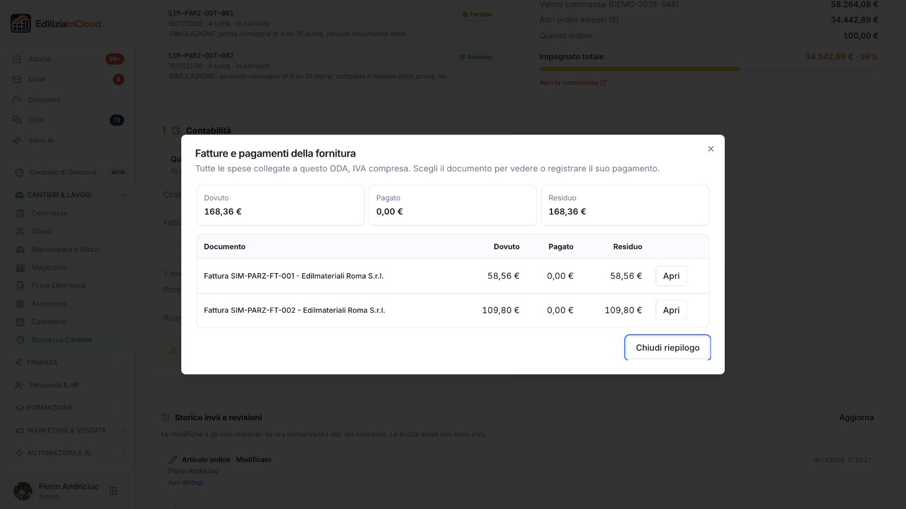
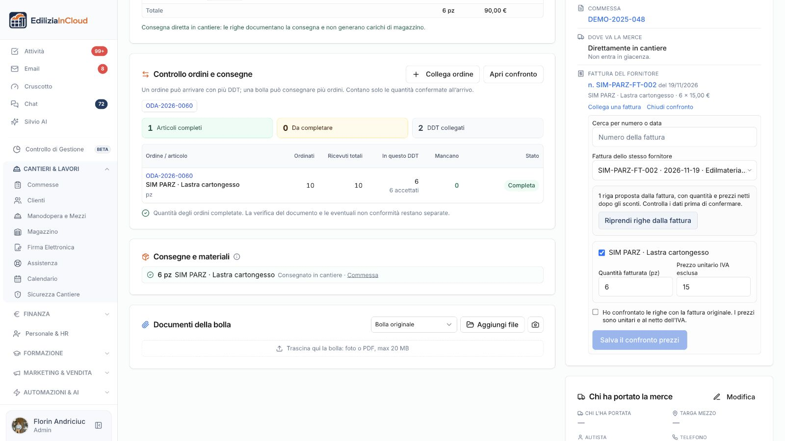

# Flusso acquisti: riepiloghi e confronto prezzi

Collaudo del 19 novembre 2026, su localhost:8096 con l'azienda Demo Azienda 2 S.r.l. e la commessa DEMO-2025-048. Solo documenti di simulazione, nessun pagamento registrato.

## Correzioni

- «Pagamenti e residuo» apre tutte le spese dell'ODA con dovuto, pagato e residuo complessivi. Il dettaglio apre il documento scelto, anche la seconda fattura. I totali usano la RPC dei pagamenti effettivi, compresi gli storni, senza dedurre gli importi dalla sola spunta di pagamento. Le fatture ripartite mostrano la quota dell'ODA e spiegano l'attribuzione proporzionale dei pagamenti.
- Le quantità ordinate, ricevute e residue si leggono separatamente dai valori ai prezzi dell'ODA. Un aumento del prezzo fatturato non viene descritto come merce mancante. Un'eccedenza su una riga non nasconde il residuo di un'altra e non si sommano unità diverse.
- In commessa i costi registrati sono distinti dagli impegni prudenziali degli ODA già inclusi nel margine. Il totale canonico non viene modificato. Una fornitura fatturata sotto il prezzo dell'ODA può conservare un impegno: questa correzione lo rende esplicito, senza introdurre nuove regole di chiusura contabile.
- Il DDT propone l'unica fattura già collegata e legge quantità e prezzi netti dopo gli sconti dal suo XML, rispettando il corpo del documento. Gli abbinamenti richiedono descrizione/codice univoci e unità compatibili. Le posizioni ambigue restano da compilare. La proposta non scrive dati e il salvataggio richiede la conferma dell'operatore. Cambiare fattura azzera modifiche e conferma precedenti.
- Consegne, collegamenti, importazioni e contabilizzazioni invalidano le letture interessate anche nelle altre schede dello stesso browser. Il segnale non contiene dati del documento e non si ritrasmette in ciclo.

## Prova nell'applicazione

ODA-2026-0060, una riga «SIM PARZ · Lastra cartongesso», ordinati 10 pezzi a 10 € netti.

| Documento | Quantità | Prezzo netto | Imponibile | IVA compresa |
| --- | ---: | ---: | ---: | ---: |
| SIM-PARZ-DDT-001 / SIM-PARZ-FT-001 | 4 | 12 € | 48 € | 58,56 € |
| SIM-PARZ-DDT-002 / SIM-PARZ-FT-002 | 6 | 15 € | 90 € | 109,80 € |
| Totale | 10 | media 13,80 € | 138 € | 168,36 € |

- Il riepilogo mostra 10 ordinati, 10 ricevuti e 0 da ricevere.
- «Pagamenti e residuo» mostra 168,36 € dovuti, 0 € pagati e 168,36 € residui. Aprendo la seconda fattura il dettaglio mostra 109,80 €.
- Il secondo DDT propone automaticamente SIM-PARZ-FT-002, 6 pezzi a 15 €. Il salvataggio resta disabilitato senza conferma.
- È stato ripetuto il salvataggio del confronto prezzi. La verifica dei record è rimasta a 2 consegne, 2 valorizzazioni e 2 costi per 138 € netti, con 10 pezzi ricevuti e costo unitario dell'articolo 13,80 €. Nessun duplicato nel caso provato.
- La commessa mostra 59.948,04 € di costi registrati, 0 € di impegni aggiuntivi e margine di −1.683,96 €. La rilettura dei prezzi non ha duplicato i costi.

## Verifiche automatiche

- 95 test superati su 11 file: quantità parziali, unità diverse, pagamenti/storni, ripartizioni, costi e impegni, note di credito, proposte XML scontate, documenti con più corpi, ambiguità, cambio fattura, errori di lettura e aggiornamento tra schede senza ritrasmissione.
- `npm run typecheck:ci`: zero errori, soglia zero.
- Build Vite di produzione completata (11.977 moduli).
- ESLint dei componenti e helper del flusso: nessun errore o avviso. In `FattureRicevutePage.tsx` restano due errori preesistenti `set-state-in-effect`, verificati anche sul file originale di HEAD; le modifiche riguardano solo le invalidazioni dopo i salvataggi.
- La suite degli 11 file è inclusa nel job CI del gruppo economics.

I casi di reso, annullamento, sostituzione del fornitore e chiusura definitiva a un prezzo più basso richiedono un collaudo operativo dedicato. La prova descritta non li certifica.
